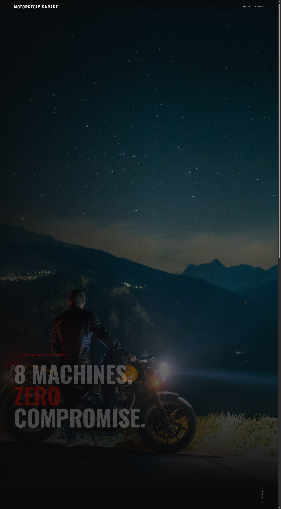

# 🏍️ MOTORCYCLE GARAGE — Zero Compromise

A modern, high-contrast digital garage featuring an curated selection of super-bikes, hyper-nakeds, electrics, and cruisers[cite: 2]. Built with high-performance CSS styling, dynamic category filtering, and sleek interactive cards.



---

## ⚡ Features

- **Interactive Category Filtering:** Instantly filter machines across **Superbike**, **Hyper Naked**, **Retro**, **Cruiser**, **Adventure**, and **Electric** classes[cite: 2].
- **Metrics Dashboard:** Real-time stats engine highlighting power outputs up to **214 hp**, displacement up to **1,103 cc**, and machine origins across **6 countries**[cite: 2].
- **Dark Aesthetic UI:** High-contrast dark theme powered by custom CSS variables, sleek typography (`Oswald` & `Inter`), and vibrant crimson accents (`#e10600`)[cite: 2, 3].
- **Card Specs & Pricing:** Detailed vehicle previews complete with pricing badges, class tags, and high-res imagery[cite: 2].

---

## 🛠️ Built With

- **HTML5:** Semantic structure and custom data attributes[cite: 3].
- **CSS3:** Custom properties (`--bg`, `--red`), CSS Grid/Flexbox, and smooth scrolling interactions[cite: 3].
- **Vanilla JavaScript:** Responsive tag filtering and UI interactions.
- **Google Fonts:** `Oswald` and `Inter`[cite: 3].

---

## 📁 Project Structure

```text
motorcycle-garage/
├── assets/                  # High-resolution motorcycle images[cite: 3]
│   ├── bonneville-t120.jpg
│   ├── hero.jpg
│   ├── livewire.jpg
│   ├── mt-09.jpg
│   ├── nightster.jpg
│   ├── ninja-h2.jpg
│   ├── panigale-v4.jpg
│   ├── r1300gs.jpg
│   └── s1000rr.jpg
├── index.html               # Main application markup & embedded styles[cite: 3]
├── screenshot.png           # Repository preview image[cite: 3]
└── README.md